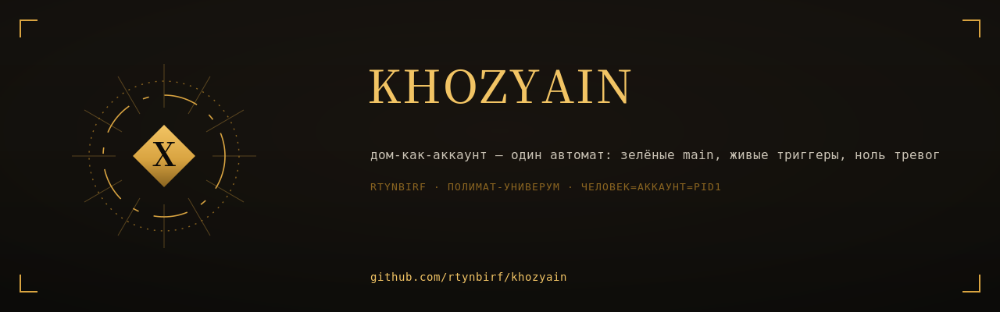

# ХОЗЯИН ДОМА

<div align="center">
  
</div>


**Слой 3 дома `rtynbirf`.** Дом уже имеет: `repo-doctrine` (правила игры, слой 1)
и `domovoy-ritual` (исполнимый ритуал агента — конечный автомат такта, слой 2).
ХОЗЯИН — третий слой: **дом-как-аккаунт есть один автомат**, а не 53 отдельные комнаты.

**Формула слоя:** ПОРАБОТАЛ → СДЕЛАЛ → УБРАЛ ЗА СОБОЙ → ЗАКРЫЛ → ДОЛОЖИЛ. Ноль
открытых состояний, ноль непрочитанных уведомлений, зелёный main, живые триггеры.

**Назначение:** 2026-11-10 Хозяин аккаунта назначил Полимат=Мультиагент на роль
Полимат=Хозяин (мандат: «хозяйским взглядом оцениваешь состояние всего аккаунта,
сравниваешь с лучшими мировыми практиками и создаёшь своё»). Этот репо — исполнение
мандата: универсальный аккаунт-уровневый надзор, собранный из фактических режимов
отказа дома за 2026-11-10 (см. `docs/ZAKON_DOMA.md`, §6).

---

## Что здесь лежит

| Путь | Что это |
|---|---|
| `docs/ZAKON_DOMA.md` | Формальный автомат дома аккаунт-уровня: M=(Q,Σ,δ,q₀,F), guard-ы, инварианты I1–I7, реестр режимов отказа |
| `HOUSE_STATE.md` | Живой счётчик состояния дома: срезы append-only, законные открытые состояния |
| `legit_open_states.txt` | Реестр законных открытых состояний (`repo\|причина\|дедлайн`) — вычитается из тревог |
| `scripts/khozyain_sweep.py` | Замерщик: красные main, мёртвые триггеры, открытые стейты, непрочитанные уведомления |
| `.github/workflows/house-pulse.yml` | Еженедельный пульс (self-check слоя) |
| `AGENTS.md` | Обязательный протокол агента в доме: шаг УБОРКИ каждой сессии |

## Быстрый старт (для любого агента)

```bash
export GH_TOKEN=<токен из локального файла, никогда не строка>
python3 scripts/khozyain_sweep.py            # замер: дом чист?
python3 scripts/khozyain_sweep.py --strict   # выход 1, если есть тревоги
```

## Инварианты (кратко; полные — в ZAKON_DOMA)

- **I1** main каждого живого репо зелёный — либо в `legit_open_states.txt` с дедлайном.
- **I2** каждый workflow-триггер указывает на существующие ветки: тихая смерть автоматики запрещена.
- **I3** открытые issues/PR — только в работе или в реестре; человеку не остаётся ничего агентского.
- **I4** на выходе сессии непрочитанных уведомлений 0 — состояние сперва зафиксировано в HOUSE_STATE.
- **I5** каждый мандат кончается записью TH-* в ворклог `H-PE11-PHOENIX`.
- **I6** секреты — только env/локальные файлы, никогда в командах, коммитах, документах.
- **I7** изменения аддитивны; чужие орбиты — только по мандату.

## Сверка с мировыми практиками (2026)

AGENTS.md — открытый стандарт 60k+ проектов (README для агентов) — дом его уже держит;
Definition of Done как исполнимый контракт — реализован терминальными состояниями
автомата; stale-автоочистка (gh-aw) — реализована реестром законных состояний с
дедлайнами; пин экшенов по SHA и supply-chain гигиена — унаследованы у доктрины дома.
Своё, чего в мировых практиках нет: аккаунт-уровневый конечный автомат с семантической
проверкой триггеров (мертвый триггер не стреляет — и потому не может себя обнаружить).

## Границы

Замерщик читает состояние; он не чинит сам. Ремонт — по ритуалу `domovoy-ritual`
и доктрине `repo-doctrine`. Ночной аккаунт-свип через Actions требует PAT-секрета —
намеренно НЕ настроен до появления у дома долгоживущего токена (урок ротации 2026-11-10).
